

  


<!-- PROFILE:BADGES:START -->

<!-- PROFILE:BADGES:END -->

## About me

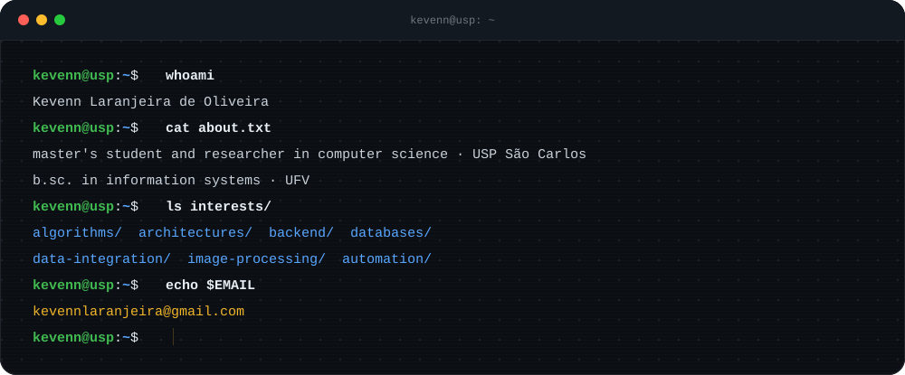

I'm a master's student in Computer Science and a researcher at USP, in São Carlos, Brazil. Before that I got my bachelor's degree in Information Systems at the Federal University of Viçosa (UFV).

I learn best by building. I take the theory, turn it into code, measure the result and keep adjusting until the solution is clear to whoever comes next. The public repositories here include a data warehouse built on São Paulo's open education data with Python and DuckDB, and a voting system in Java and TypeScript running on Docker. There's also a C lab for sorting algorithms and a Python app for image processing.

## Tech stack


## Featured projects

<!-- PROFILE:PROJECTS:START -->

<a href="https://github.com/kevennlaranjeira/OLAP2026">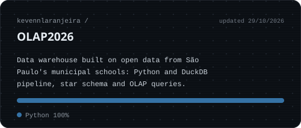</a>
<a href="https://github.com/kevennlaranjeira/VotoDistribuido">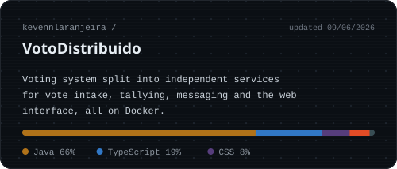</a>
<a href="https://github.com/kevennlaranjeira/SortLab">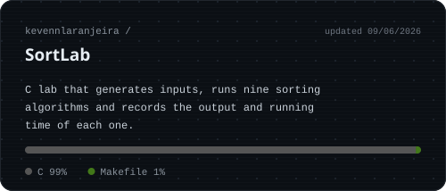</a>
<a href="https://github.com/kevennlaranjeira/projeto_pdi">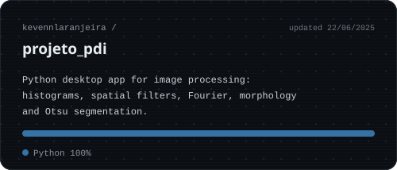</a>

<!-- PROFILE:PROJECTS:END -->

## Repository languages

<!-- PROFILE:LANG_STATS:START -->

  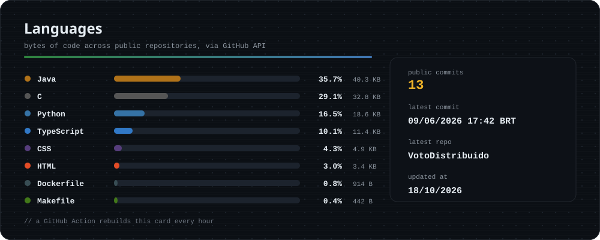

<!-- PROFILE:LANG_STATS:END -->

## Projects in motion

Three of my projects, animated. The architecture, the algorithms and the filter follow what is in each repository.

In [VotoDistribuido](https://github.com/kevennlaranjeira/VotoDistribuido), each vote goes through the load balancer, lands on one of three collector replicas and waits in the RabbitMQ queue until the aggregator consumes it. The result goes back to the screen over WebSocket.

<a href="https://github.com/kevennlaranjeira/VotoDistribuido"></a>

In [SortLab](https://github.com/kevennlaranjeira/SortLab), four algorithms sort the same shuffled array. Every comparison and every swap takes the same time in the animation, so the gap between O(n²) and O(n log n) is easy to see.

<a href="https://github.com/kevennlaranjeira/SortLab">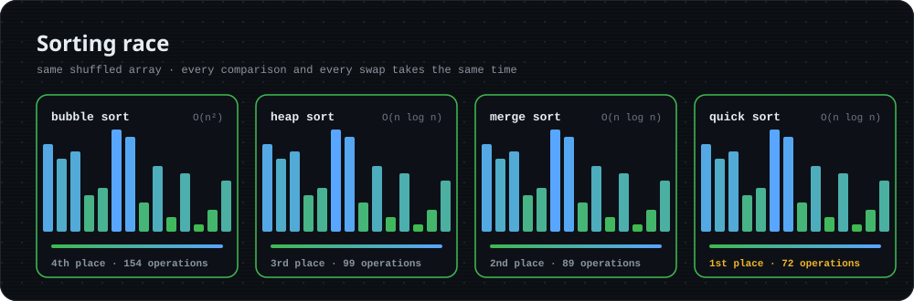</a>

In [projeto_pdi](https://github.com/kevennlaranjeira/projeto_pdi), the Sobel filter sweeps the image with a 3×3 window and highlights the edges. The edges on the right were computed pixel by pixel from the image on the left.

<a href="https://github.com/kevennlaranjeira/projeto_pdi"></a>

## Contributions

  <picture>
    <source media="(prefers-color-scheme: dark)" srcset="https://raw.githubusercontent.com/kevennlaranjeira/kevennlaranjeira/output/github-snake-dark.svg" />
    <source media="(prefers-color-scheme: light)" srcset="https://raw.githubusercontent.com/kevennlaranjeira/kevennlaranjeira/output/github-snake.svg" />
    
  </picture>

## Contact

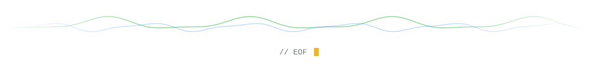
